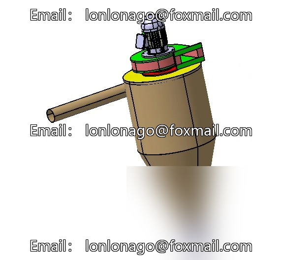
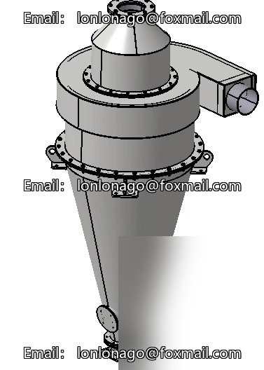
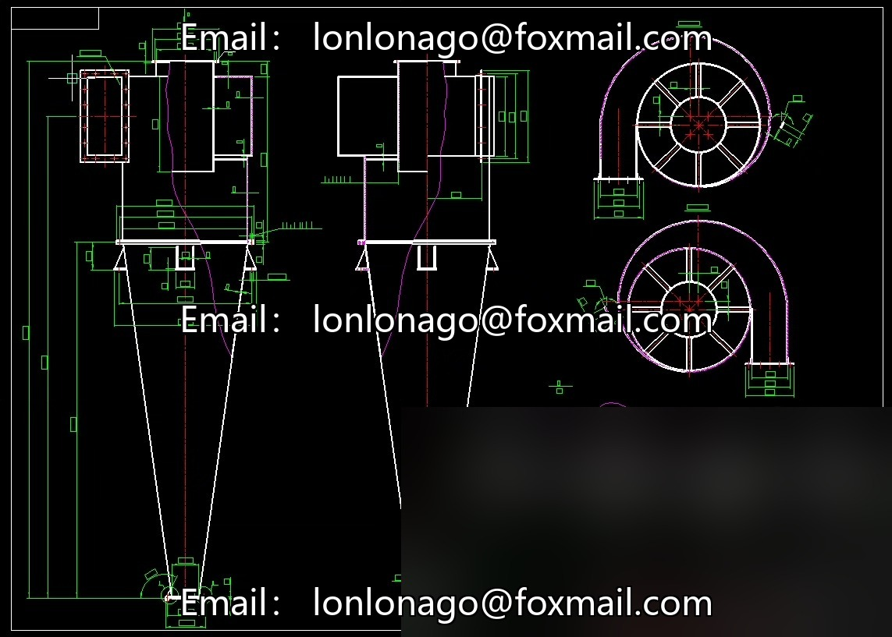
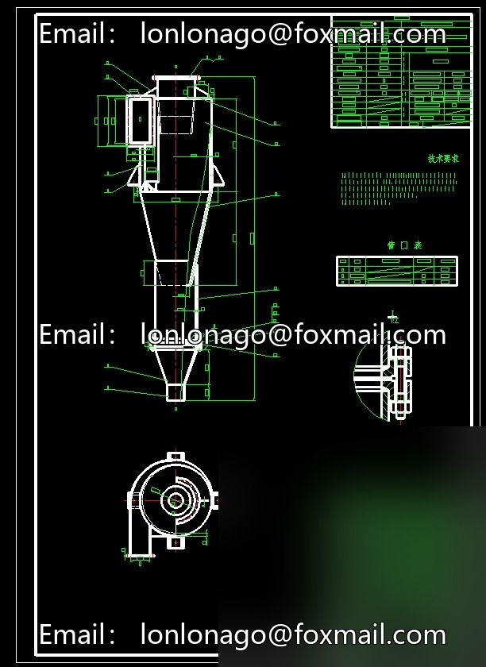

# Cyclone 3D model is

## Body

Filter dust 3D model editable filter number models 3D filter 2D drawings filter CAD drawings, multiple models such as vortex filter, etc., can be opened and edited with Catia UG SolidWorks and other software. A031 Others include various other 3D drawings, service of modeling and number model modification, etc., specific details to be discussed.

The dust collector offers editable 3D models, including 3D models, 2D drawings and CAD drawings, along with multiple models such as wind-swirl dust collectors, and supports opening and editing via Catia, UG SolidWorks.

<!-- AI_ENRICHED -->

## Images

## Payment

Here is a pay link on Stripe ( https://buy.stripe.com/3cs8yP7sY87d0vu9AB ). Please contact me lonlonago@foxmail.com after funding $89, and I will send you a complete data files , thank you!

